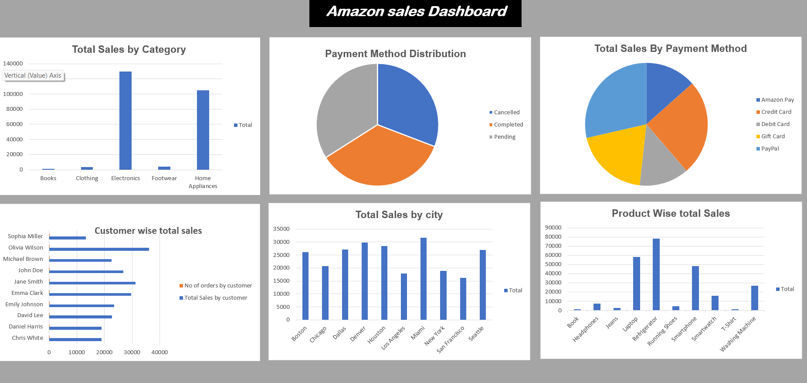
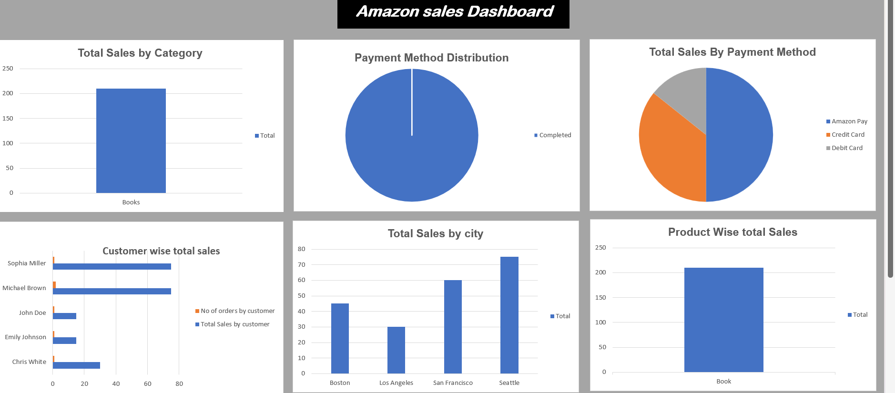

# amazon-sales-analysis-excel
Interactive Excel sales dashboard analyzing 250 Amazon orders ($243,845 revenue) across categories, cities, payment modes, and order statuses using PivotTables and connected slicers.
# Amazon Sales Performance Analysis — Interactive Excel Dashboard

An end-to-end exploratory and descriptive sales analysis of **250 Amazon e-commerce orders** (February–April 2025) built entirely in **Microsoft Excel**. The project covers data cleaning, calculated feature engineering, multi-table PivotTable modeling, and an interactive dashboard powered by connected PivotTable slicers.

---

## 1. Business Problem Statement
E-commerce sellers rely on transactional order data to optimize product assortment, track fulfillment efficiency, and target high-performing regions[cite: 1]. This analysis addresses six core business questions:
1. Which **product categories** and individual **products** generate the highest revenue?[cite: 1]
2. Which **customer locations (cities)** drive the strongest and weakest sales?[cite: 1]
3. How do **payment methods** compare by total revenue and order volume?[cite: 1]
4. What is the breakdown of **order statuses** (`Completed`, `Pending`, `Cancelled`)?[cite: 1]
5. Who are the highest-value **repeat customers** by total spend and order frequency?
6. How do sales and order volumes trend across **February, March, and April 2025**?

---

## 2. Dataset Overview
* **Source:** Amazon Order-Level Sales Dataset (`amazon_sales_data 2025 _cleaned`)
* **Volume:** 250 transactions | 714 total units sold | **$243,845** total revenue
* **Date Range:** February 2, 2025 – April 2, 2025
* **Dimensions & Metrics:**
  * **Identifiers & Dates:** `Order ID`, `Date`, `Month`
  * **Product Details:** `Product` (10 items), `Category` (5 categories), `Price`, `Quantity`, `Total Sales`
  * **Customer & Order Info:** `Customer Name` (10 buyers), `Customer Location` (10 US cities), `Payment Method` (5 modes), `Status` (`Completed`, `Pending`, `Cancelled`)

---

## 3. Methodology & Excel Workflow

### Step 1: Data Cleaning & Validation (`amazon_sales_data 2025 _cleaned`)
* Checked for duplicate `Order ID` records and verified zero missing values across all 250 rows[cite: 1].
* Standardized data types: `Date` formatted as standard Date (`YYYY-MM-DD`), and `Price`, `Quantity`, and `Total Sales` formatted as numeric fields[cite: 1].
* Standardized text casing and whitespace across categorical columns (`Product`, `Category`, `Customer Location`, `Payment Method`, `Status`)[cite: 1].
* Validated transactional accuracy across every row (`Total Sales = Price × Quantity`)[cite: 1].
* Converted the cleaned range (`A1:L251`) into a structured Excel Table (`amazon_sales_data_2025__1`) for dynamic PivotTable syncing.

### Step 2: Feature Engineering
* Created a calculated **`Month`** column using `=TEXT([@Date],"MMMM")` to enable clean monthly aggregation and slicer filtering (`February`, `March`, `April`)[cite: 1].

### Step 3: PivotTable Modeling (`Pivot_table`)
Built **6 PivotTables** from a unified PivotCache to summarize key business dimensions[cite: 1]:
1. **Total Sales by Category** (`Sum of Total Sales`)[cite: 1]
2. **Total Sales by Product** (`Sum of Total Sales`)[cite: 1]
3. **Total Sales by Customer Location** (`Sum of Total Sales`)[cite: 1]
4. **Order Status Distribution** (`Count of Status`)[cite: 1]
5. **Total Sales by Payment Method** (`Sum of Total Sales`)[cite: 1]
6. **Customer Performance** (`Sum of Total Sales` and `Count of Order ID` per customer)[cite: 1]

### Step 4: Interactive Dashboard & Slicer Connections (`Dashboards`)
* Designed 6 linked PivotCharts on a gridline-free dashboard canvas[cite: 1].
* Configured **6 PivotTable Slicers** (`Product`, `Category`, `Status`, `Payment Method`, `Customer Location`, and `Month`) and linked each slicer to all 6 PivotTables via **Report Connections** for synchronized cross-filtering[cite: 1].

---

## 4. Key Insights & Findings

| Metric / Dimension | Key Finding |
| :--- | :--- |
| **Overall Revenue** | **$243,845** across **250 orders** (Mean Order Value: **$975.38**, Median: **$400.00**) |
| **Top Categories** | **Electronics** (**$129,950**, **53.29%**) and **Home Appliances** (**$105,000**, **43.06%**) account for **96.35%** of total sales. |
| **Top Products** | **Refrigerator** (**$78,000**, 31.99%), **Laptop** (**$58,400**, 23.95%), and **Smartphone** (**$48,500**, 19.89%) lead product revenue. |
| **Top Cities** | **Miami** (**$31,700**, 13.00%), **Denver** (**$29,785**, 12.21%), and **Houston** (**$28,390**, 11.64%) lead regional sales; **San Francisco** (**$16,195**) trails. |
| **Order Fulfillment** | **Completed:** 88 orders (**35.20%**) \| **Pending:** 85 orders (**34.00%**) \| **Cancelled:** 77 orders (**30.80%**). |
| **Payment Methods** | **PayPal** leads revenue (**$69,645**, 28.56%, 60 orders), followed by **Credit Card** (**$61,595**, 25.26%, 54 orders). |
| **Top Customers** | **Olivia Wilson** (**$36,170**, 29 orders), **Jane Smith** (**$31,185**, 30 orders), and **Emma Clark** (**$29,700**, 32 orders). |

---

## 5. Business Recommendations
1. **Reduce the 30.80% Cancellation Rate:** Audit cancelled orders by product category, city, and payment mode using the dashboard slicers to identify stockouts, shipping delays, or payment gateway drop-offs.
2. **Protect High-Margin Appliance & Electronics Inventory:** Since Refrigerators, Laptops, and Smartphones drive over **75%** of total revenue, prioritize safety stock and bundled accessories for these core SKUs.
3. **Target Underperforming Metro Markets:** Run localized promotions or shipping incentives in lower-revenue cities like **San Francisco** ($16,195) and **Los Angeles** ($17,820) to match demand levels seen in Miami and Denver.
4. **Streamline Pending Order Processing:** With **34.00%** of orders in `Pending` status, tighten fulfillment SLAs to convert pending orders into completed revenue faster.

---

## 6. Tools & Skills Demonstrated
* **Microsoft Excel:** Data Cleaning, Structured Excel Tables, Calculated Columns (`TEXT`), PivotTables, PivotCharts, Slicers, Report Connections, and Dashboard Layout Design[cite: 1].

---

## 7. How to Use This Project
1. Download `Excel_project.xlsx` from this repository.
2. Open the file in **Microsoft Excel** (Desktop version recommended for full slicer interactivity).
3. Navigate to the **`Dashboards`** tab and click any slicer (`Month`, `Category`, `Customer Location`, `Status`, `Payment Method`, or `Product`) to dynamically filter all charts.

---
